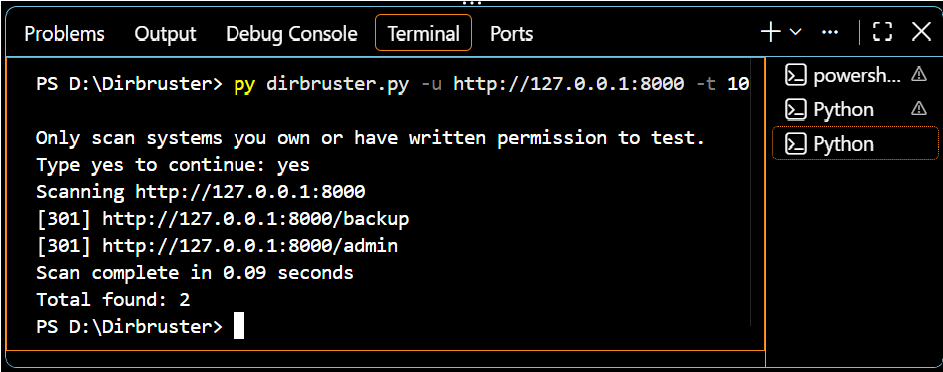

# Directory Bruteforcer

A simple multi-threaded web directory scanner written in Python.
Built as Project 7 of the Cybersecurity in Python Level 1 track (Arfa Karim Technology Incubator, Lahore).

> **Disclaimer:** For educational use only. Scan only systems you own or have written permission to test. Unauthorized scanning is illegal.

## What it does
- Reads a wordlist of common folder names (admin, backup, login...)
- Sends HTTP requests to `target/word` using many threads at once
- Reports paths that exist (status codes 200, 301, 302, 403)
- Can save results to a file

## Installation
```
git clone https://github.com/4bdulqadir/directory-bruteforcer.git
cd directory-bruteforcer
pip install -r requirements.txt
```

## Usage
```
python dirbruster.py -u http://127.0.0.1:8000 -t 10 -o results.txt
```

| Option | Meaning |
|--------|---------|
| `-u` | Target URL (required) |
| `-w` | Wordlist file (default: wordlist.txt) |
| `-t` | Number of threads (default: 5) |
| `-o` | Save results to a file |

## Example output
```
[301] http://127.0.0.1:8000/admin
[301] http://127.0.0.1:8000/backup
Total found: 2
```


## What I learned
Python, HTTP status codes, threading with `concurrent.futures`, argparse, error handling.

## Author
Abdul Qadir
